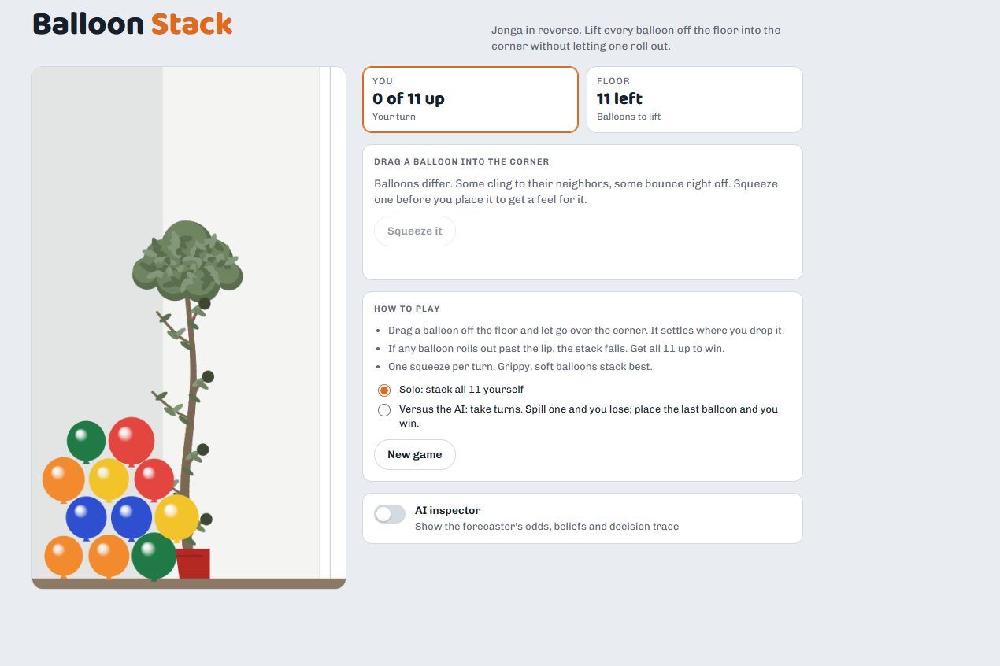
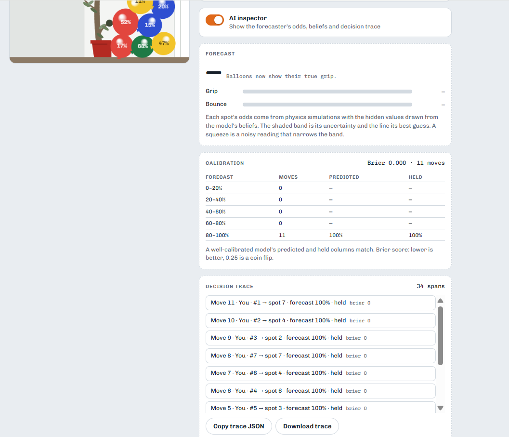
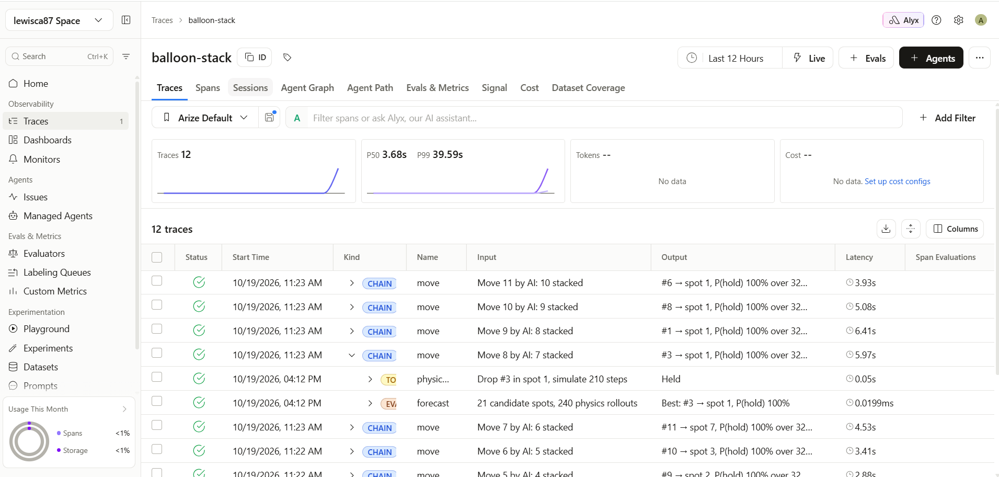

# Balloon Stack

**Reverse Jenga with balloons, and a small, fully observable probabilistic AI.**

**Play it:** https://lewisca.github.io/Balloon-Stack/



Drag 11 balloons off the floor and stack them into a corner. If any balloon rolls out past the lip, the stack falls. Every balloon has hidden **grip** and **bounce** values, so the same placement can hold with one balloon and fail with another. You can play solo or take turns against an AI forecaster that has to deal with the same uncertainty you do.

The whole game is one self-contained `index.html`. Double-click it to play; there's nothing to install.

## Why it's a probabilistic AI demo

The game is a small, end-to-end example of making decisions under uncertainty, with each step out in the open:

| Idea | How it shows up in the game |
| --- | --- |
| **Hidden variables** | Each balloon's grip and bounce drive the physics (friction, static friction, restitution) but are never shown to the player or the AI. |
| **Bayesian belief updates** | The AI keeps a Gaussian belief (mean and variance) for each balloon's grip and bounce. A *squeeze* gives a noisy reading (σ = 0.15), and a Kalman-style update shifts the mean toward that reading and shrinks the variance. The Kalman gain is reported, so you can see how much each reading counted. |
| **Monte Carlo forecasting with physics rollouts** | To score a placement, the forecaster rebuilds the current stack in a fresh [Matter.js](https://brm.io/matter-js/) world, draws every balloon's hidden values from its beliefs, drops the new balloon, and simulates. The share of rollouts in which nothing spills is its estimate of P(hold). |
| **An AI opponent that picks by expected success** | On its turn, the AI squeezes whichever balloon it's least sure about, shortlists the three balloons it believes are grippiest, runs 8 rollouts for every spot, refines the top three to 32 rollouts, and plays the one most likely to hold. |
| **Calibration scoring** | Every forecast is graded against what actually happened. The inspector shows a reliability table (predicted vs. actual by bucket) and the running **Brier score**. A headless check measures calibration over many simulated games and fails the build if it drifts. |
| **Decision tracing for observability** | Each game is an OpenTelemetry session, and each move is its own trace: `move > squeeze / forecast / physics.settle`. Spans record priors, readings, posteriors, candidate odds, the AI's decision, and the outcome. Spans use OpenInference kinds (AGENT, CHAIN, TOOL, EVALUATOR) with input and output summaries. They export as OTLP to [Arize AX](https://arize.com/), where each game shows up as a session you can replay and filter. |

The player's view has no numbers. Turn on the **AI inspector** to see per-spot odds, belief bars with uncertainty bands, the calibration table, the Brier score, and the decision trace.



## How to play

1. Drag a balloon off the floor and let go over the corner. It settles where you drop it.
2. If any balloon rolls out past the lip, the stack falls. Get all 11 up to win.
3. You get one **squeeze** per turn. It tells you roughly how grippy and bouncy a balloon is. Grippy, soft balloons stack best.
4. Choose **Solo** to stack all 11 yourself, or **Versus the AI** to take turns. In versus mode, whoever spills a balloon loses and whoever places the last one wins.

## Running the build and checks

You need Node 18 or later.

```bash
npm install
npm run build   # assemble index.html from src/
npm run check   # headless calibration check; fails if Brier > 0.08
npm run trace   # play a seeded game headlessly and write docs/sample-trace.json
npm run export -- <trace.json>   # send a downloaded trace to Arize AX (see Observability with Arize)
npm run relay                    # play at http://localhost:4320; each finished game goes to Arize AX automatically
```

`npm run check` plays seeded games in Node, forecasts each move with 16 rollouts, plays it out for real, and reports the result:

```
moves 74 brier 0.025
bucket 0-20%: n=5 predicted 3% actual 20%
bucket 20-40%: n=2 predicted 31% actual 50%
bucket 60-80%: n=1 predicted 75% actual 100%
bucket 80-100%: n=66 predicted 99% actual 100%
PASS: Brier 0.025 <= 0.08
```

Every push to `main` runs the build and the check in GitHub Actions. The game is published to GitHub Pages only if both pass.

### Layout

```
src/head.html    styles
src/body.html    markup
src/sim.js       physics world, belief sampling, Monte Carlo rollouts (shared with Node)
src/game.js      game loop, AI, tracing, input, rendering
build.js         concatenates src/ into index.html
index.html       the built single-file game
headless/        calibration check, sample-trace generator, OTLP exporter and relay
docs/            sample trace and screenshots
```

## Observability with Arize

The forecaster is an agent that makes decisions under uncertainty, so it's instrumented the way you'd instrument an AI system in production. Every decision is traced with its inputs, its reasoning steps, its prediction and the real outcome. The traces go to [Arize AX](https://arize.com/), where each game can be replayed, filtered and measured.



### The trace model

Each game is a **session**, and each balloon placement is its own **trace**. Spans follow [OpenInference](https://github.com/Arize-ai/openinference) conventions, so Arize fills in its Kind, Input and Output columns:

```
session 91297a41…                          session.id on every span
├── game            AGENT       solo game, 11 balloons, AI first  →  won: 11 stacked, Brier 0.000
├── move 1          CHAIN       Move 1 by AI: 0 stacked           →  #2 → spot 1, P(hold) 100% over 32 rollouts, held
│   ├── squeeze         TOOL        squeeze #1: grip 0.50 ± 0.25  →  posterior grip 0.31 ± 0.13
│   ├── forecast        EVALUATOR   21 candidate spots, 240 rollouts  →  best: #2 → spot 1, P(hold) 100%
│   └── physics.settle  TOOL        drop #2 in spot 1             →  held
├── move 2          CHAIN       …
```

Under the summaries, every span keeps the full detail as attributes: priors, readings, Kalman gains, posteriors, every candidate spot with its rollouts and P(hold), the AI's decision with its shortlist, the outcome, and each move's Brier contribution. The `game` span records the true hidden values, which are revealed when the game ends.

### Sending games to Arize AX

Get your Space ID and API key from *Space Settings* in Arize AX. Put them in a file named `.env` in the project folder:

```
OTEL_EXPORTER_OTLP_TRACES_HEADERS=space_id=<space-id>,api_key=<api-key>
```

The first time you run `npm run relay` without credentials, it creates this file, opens it in Notepad on Windows, and tells you what to replace. `.env` is listed in `.gitignore`, so it's never committed. The same setting also works as an ordinary environment variable. Traces go to `https://otlp.arize.com/v1/traces`, in the project **balloon-stack**. For an EU space, add `OTEL_EXPORTER_OTLP_TRACES_ENDPOINT=https://otlp.eu-west-1a.arize.com/v1/traces`. To use a different project name, add `OTEL_RESOURCE_ATTRIBUTES=openinference.project.name=<name>`.

**Automatically, with the local relay.** Run `npm run relay` and leave it running, then play at **http://localhost:4320**. When it starts, it checks your Space ID and API key with Arize and tells you whether they were accepted. The relay serves the game there. As soon as a game ends, the page sends its trace to the relay, which forwards it to Arize and logs each game. If you start a new game partway through one, the unfinished game is sent too. The inspector shows whether the last game went through. Your API key stays in the relay process; the page never sees it.

- **Play at http://localhost:4320.** The page and the relay are then the same site, so the browser has nothing to block.
- **GitHub Pages site or a double-clicked `index.html`:** these also try to send to the relay, but browsers increasingly block public sites from contacting `localhost` unless you allow it. If the inspector says the trace wasn't sent, play at http://localhost:4320 instead.
- **Closing the tab:** this sends an unfinished game only if its trace is small, so finish the game or start a new one before closing.

**Manually.** Open the **AI inspector**, click **Download trace**, and run `npm run export -- path/to/balloon-stack-trace-….json`. To try it without playing first, send the sample: `npm run export -- docs/sample-trace.json`.

Then open the **balloon-stack** project in Arize. **Traces** lists every move, and **Sessions** groups them by game.

### What you can do with the traces

- **Replay a game decision by decision.** Open a session to step through its moves in order. Each move shows what the AI believed, what it predicted and what happened.
- **Find the failures.** Filter spans on `outcome.held = false` to find every placement that spilled, with the forecast made just before it.
- **Check calibration in production terms.** Every `move` span carries both `prediction.p_hold` and `outcome.held`, the same pair the inspector's reliability table and the Brier score are computed from. Across many games, the traces show whether a 90% forecast holds about 90% of the time.
- **Audit the reasoning.** The Input and Output columns read as a log of the agent's choices: which balloon it squeezed, how much the reading changed its belief, and which spot it chose at what odds.

The project doesn't define Arize evals or monitors yet. A natural next step would be an eval that scores each move's forecast against its outcome.

### A trace excerpt

From [`docs/sample-trace.json`](docs/sample-trace.json), a solo game the forecaster played headlessly and won with all 11 balloons stacked. On move 3 it squeezed balloon #5. The reading pulled the bounce estimate from 0.5 down to 0.381 and cut both variances from 0.063 to 0.017. Shown here with attributes flattened for reading; the file uses OTLP's `{key, value}` encoding.

```json
{
  "name": "squeeze",
  "traceId": "6221557ee486a5994e49caafaba4fff4",
  "parentSpanId": "66e3b789af583deb",
  "attributes": {
    "session.id": "91297a415a7c277f06c5150acb132185",
    "balloon.id": 5,
    "prior.grip_mean": 0.5,       "prior.bounce_mean": 0.5,     "prior.grip_var": 0.063,
    "reading.grip": 0.551,        "reading.bounce": 0.339,      "reading.noise_sd": 0.15,
    "kalman_gain.grip": 0.735,
    "posterior.grip_mean": 0.537, "posterior.bounce_mean": 0.381, "posterior.grip_var": 0.017
  }
}
```

It then compared 21 candidate spots across three balloons (240 rollouts in total), placed #5 in spot 2 with a 100% forecast, and the stack held:

```json
{
  "name": "move",
  "traceId": "6221557ee486a5994e49caafaba4fff4",
  "spanId": "66e3b789af583deb",
  "attributes": {
    "session.id": "91297a415a7c277f06c5150acb132185",
    "move.number": 3, "move.actor": "ai", "stack.size": 2,
    "balloon.id": 5, "spot": 2,
    "prediction.p_hold": 1, "prediction.rollouts": 32,
    "outcome.held": true, "brier.contribution": 0
  },
  "events": [{ "name": "ai.decision", "attributes": {
    "policy": "max p_hold over top-3 balloons by believed grip",
    "shortlist": [5, 6, 7], "chosen_balloon": 5, "chosen_spot": 2, "p_hold": 1 } }]
}
```

### Other backends

The trace is standard OTLP, so any OpenTelemetry backend can receive it: set `OTEL_EXPORTER_OTLP_TRACES_ENDPOINT` and `OTEL_EXPORTER_OTLP_TRACES_HEADERS` for that backend.

## Lessons learned: a calibration bug found through the inspector

In an early build, the inspector's calibration table looked wrong. The forecaster rated safe moves near 0%, and those moves then held in the real game. The forecasts weren't just noisy; they were confidently pessimistic, and the Brier score was **0.178**.

The cause was in how each simulation rebuilt the stack. The real stack has settled: its balloons have come to rest against each other, and static friction holds them there. Each rollout, though, rebuilt the stack from saved positions in a brand-new physics world, with full gravity applied on the first step and none of that settled contact. The copies sagged and collapsed **on their own**, before the new balloon was even added. The forecaster was measuring how a freshly dropped pile behaves, not the stack in front of it.

The fix eases gravity in over the first 90 steps, with extra air damping, so each copy settles into contact before the candidate balloon is dropped. After that change the Brier score went from **0.178 to 0.025** in testing. `npm run check` now guards that number, so a regression fails CI.

What I took from it:

- **Calibration is a stronger test than accuracy.** A forecaster can rank moves in a reasonable order and still be badly miscalibrated. A reliability table showed the problem right away.
- **Make the model's reasoning observable.** Without per-move spans showing predicted odds next to outcomes, this would have looked like "the AI is a bit timid."
- **A simulation is a model too.** Monte Carlo is only as good as the simulator's starting state. Rebuilding state is where hidden assumptions creep in.

## License

[MIT](LICENSE)
